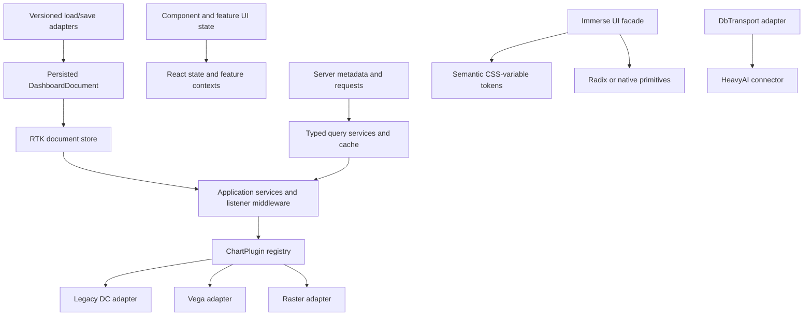

# Immerse Architecture Modernization

## Goals

- Reduce Redux to clearly owned, durable application state.
- Remove application-authored Reselect patterns and replace sagas.
- Consolidate UI components and styling behind one Immerse-owned system.
- Make new chart types easy to add through a typed plugin contract.
- Move reusable subsystems into workspace packages in the Immerse repository.
- Migrate from npm to pnpm, with catalog-managed shared dependency versions across the application and packages.
- Preserve compatibility with existing dashboards, chart configurations, embeds, and plugins throughout the migration.

## Recommendation

Do not rewrite Immerse wholesale. The repository has a usable compatibility boundary but severe internal coupling. A broad rewrite would need to reproduce dashboard migrations, crossfilter behavior, more than 30 chart registrations, and the external embed API before delivering value.

Use selective rewrites behind adapters while keeping every milestone shippable:

- Preserve saved-state behavior in [`src/actions/dashboard-action-creators.ts`](src/actions/dashboard-action-creators.ts), [`src/reducers/load-dashboard-higher-order-reducer.js`](src/reducers/load-dashboard-higher-order-reducer.js), and [`src/charts/utils/chart-versioning.js`](src/charts/utils/chart-versioning.js).
- Refactor the application shell and persistence path in place.
- Selectively rewrite filter orchestration, chart runtime boundaries, UI primitives, and mega-components such as [`src/vega/charts/combo-chart/combo-chart.ts`](src/vega/charts/combo-chart/combo-chart.ts).
- Establish the repository as a pnpm workspace and move reusable domain/runtime code into `packages/`.
- Strangler-migrate legacy chart engines and split repositories one chart or domain at a time, preserving source history where practical.

## Compatibility and rollout policy

Compatibility is an explicit release contract, not just successful loading of historical fixtures:

- **Loading historical documents:** the new application must load every supported historical dashboard and chart configuration.
- **Supporting older application readers:** before changing persisted output, document which older Immerse versions must still read newly saved dashboards. Do not assume backward-save compatibility or silently drop it.
- Until that reader/writer support matrix is agreed, preserve the existing wire format and legacy fields. Making omnifilters canonical internally does not by itself authorize removing legacy `filters` from saved output.
- Keep dashboard configuration, embeds, and external API schemas compatible across each supported release boundary. Define behavior for unknown chart types, plugin versions, and fields without silently losing saved data.
- Roll out replacements behind scoped switches, retaining the legacy implementation until parity and performance gates pass. Record the rollback procedure for each cutover.
- A runtime switch cannot undo a persisted schema change. Before enabling a new writer, demonstrate a compatible writer, tested downgrade path, or retained original document sufficient for the agreed rollback policy.

## Findings

### Redux and state ownership

[`src/reducers/index.js`](src/reducers/index.js) has 37 top-level slices containing four different categories of state:

1. Persisted dashboard state.
2. Server and query results.
3. Chart rendering lifecycle state.
4. Component and feature UI state.

These categories have different lifetimes but are reset and persisted inconsistently. For example, [`src/reducers/clear-dashboard.js`](src/reducers/clear-dashboard.js) and [`src/reducers/reset-app-state-higher-order-reducer.js`](src/reducers/reset-app-state-higher-order-reducer.js) reset different subsets of dashboard state, creating concrete stale-state risk.

The filter model is also duplicated. Both `filters` and `omnifilters` are persisted, while [`src/vega/actions/filter-action-creators.ts`](src/vega/actions/filter-action-creators.ts) explicitly dual-writes to Redux and legacy crossfilter.

Reselect is a symptom rather than the primary cause. It appears in roughly 19 source files, with deep-equality and selector-returning-selector patterns concentrated in files such as [`src/components/parameters/selectors.js`](src/components/parameters/selectors.js). Removing it will simplify the code, but eliminating duplicated and derived stored state provides the larger benefit.

### Async workflows

[`src/store/create-store-with-services.js`](src/store/create-store-with-services.js) runs saga, thunk, promise middleware, and custom middleware together. Raster and dashboard sagas coordinate state, services, rendering, cancellation, and error handling. In addition, dozens of files bypass normal React and dependency boundaries through [`src/store/importableStore.js`](src/store/importableStore.js).

Sagas should be replaced by typed application services, Redux Toolkit listener middleware or thunks where Redux coordination is appropriate, and explicit `AbortController` cancellation. Existing generator workflows should not be translated line-for-line.

Cancellation must distinguish stopping transport/backend work from discarding obsolete results. Define request generations, dashboard/session identity, queue/coalescing behavior, cache ownership and invalidation, and teardown ownership. The current queue can replace pending work and share results among callers; changing those semantics requires explicit tests and a deliberate decision.

### Chart architecture

[`src/charts/chart-registration.js`](src/charts/chart-registration.js) is a useful foundation. It centralizes metadata, components, settings, colors, export behavior, versioning, crossfilter overrides, and addons.

However, significant chart behavior remains outside the registry:

- Rendering is split among DC, Vega, raster sagas, DeckGL, and custom React paths.
- [`src/reducers/charts/charts-reducer.ts`](src/reducers/charts/charts-reducer.ts) is approximately 1,600 lines and combines every chart family into one action namespace.
- Global code still branches directly on chart type.
- Reducers, sagas, filtering behavior, query building, and cleanup are not consistently registered by a chart definition.

The goal should be a typed `ChartPlugin` contract that makes a new chart one plugin directory plus one registry entry.

### UI and styles

The application currently has:

- Approximately 188 files importing RMWC directly.
- Approximately 24 files using MUI v4.
- 431 SCSS files sharing a global class namespace.
- A global third-party CSS stack in [`src/styles/index.js`](src/styles/index.js).
- Extensive implementation-specific patches in [`src/styles/third-party-ui/material-override.scss`](src/styles/third-party-ui/material-override.scss).

Shadcn should not be the first migration target. React 16, TypeScript 3.9, global SCSS, and MDC overrides make full shadcn/Tailwind adoption a styling-platform rewrite.

The safer target is one Immerse-owned UI package backed by:

- Semantic CSS-variable tokens.
- Accessible Radix or native primitives after the React upgrade.
- Component-scoped SCSS/CSS Modules.
- A stable application-facing API that does not expose the underlying component library.

Shadcn patterns can be reconsidered later without making shadcn itself the application boundary.

### Split libraries

Immerse-owned reusable code should live in workspace packages within this repository. This includes charting, connector/transport, filter and query parsing, draw/D3 helpers, and isolated chart implementations where appropriate.

Legacy implementations should remain behind adapters while consumers migrate. Git-SHA dependencies and imports from package internals should not remain the long-term architecture.

## Target architecture



Reusable schema, domain, runtime, and UI boundaries above should become workspace packages. Product composition, feature orchestration, and feature-local React contexts can remain in application `src`. Extract packages when their dependency direction is enforceable; do not create a package for every diagram node.

## Proposed workspace topology

```text
packages/
  dashboard-document/       versioned persisted schema, migrations, codecs
  filter-engine/            omnifilter model, filter-to-SQL, crossfilter semantics
  query-runtime/            queue, cache, cancellation, request lifecycle
  chart-core/               ChartPlugin contract, registry, shared chart state
  chart-engine-dc/          temporary legacy charting/DC runtime
  chart-engine-vega/        Vega query/spec/render integration
  chart-engine-raster/      raster/map runtime and lifecycle
  connector/                HeavyDB transport/client and typed adapter
  ui/                       tokens, primitives, component facade
  test-fixtures/            dashboard and chart compatibility fixtures
src/                        product features and application composition
```

### Package rules

- A package must have a coherent public API, independent tests and types, a clear owner, and no imports from application `src`.
- Feature code useful to only one application screen remains in `src`.
- Package dependencies flow in one direction: schema/domain packages → runtimes/adapters → application.
- Chart engines depend on `chart-core`; `chart-core` must not depend on an engine.
- Consumers import only declared package exports.
- Boundary linting and cycle checks are required before moving implementation code.
- Packages are private pnpm workspace packages initially and are built from source by the existing Webpack/Babel pipeline.
- Publishing is optional and should not dictate internal architecture.
- Owned split-repository code should be moved with Git history and license metadata where feasible.
- Existing package entry points may remain temporarily as compatibility exports.
- Compatibility exports must still obey dependency direction: a package cannot re-export application `src` code. Move self-contained implementations and their dependencies together, or keep the temporary facade in `src` until extraction is possible.
- Declare React/runtime peer requirements and resolve one compatible React instance across workspace consumers. Validate package-source resolution and transpilation in development, production, Jest, and type checking before broad source transfers.
- Define minimal document migration, chart capability, and engine lifecycle contracts early. Keep implementation migration incremental and avoid freezing an expansive plugin API before representative charts prove it.

## pnpm and dependency catalog policy

- Use pnpm for local development, CI, builds, and workspace commands. Select and pin an exact pnpm version compatible with the supported Node runtime in root `package.json` via `packageManager`; document its bootstrap procedure. Do not combine the package-manager cutover with React, TypeScript, or other deliberate dependency upgrades.
- Declare workspace membership in root `pnpm-workspace.yaml`, including `packages/*` and any retained test tooling projects. Keep the application at the repository root.
- Define shared external dependency ranges in the default `catalog` in `pnpm-workspace.yaml`; reference them with `catalog:` from root and package manifests. Use named catalogs only for documented, temporary version exceptions with an owner and removal milestone. See [pnpm catalogs](https://pnpm.io/catalogs).
- Start catalog entries from existing manifest ranges. Centralize shared runtime, UI, testing, and build dependencies as packages adopt them; enforce catalog references for catalog-managed dependencies rather than repeating literal ranges. A dependency used only by one package may stay local until sharing justifies centralization.
- Declare internal package dependencies with `workspace:*` (or an explicit workspace-compatible range when needed) so they resolve locally. Catalogs coordinate external versions; workspace declarations express internal dependency edges. See [pnpm workspaces](https://pnpm.io/workspaces).
- Treat catalog version changes as dependency changes: review the lockfile and validate all affected consumers. Catalog alignment does not replace peer compatibility checks or prove that only one React instance reaches the browser bundle.
- Maintain one committed root `pnpm-lock.yaml`. Declare workspace membership before using `pnpm import` to seed it from the existing npm lockfile, then review dependency-resolution differences; importing is not a guarantee of an identical graph. See [pnpm import](https://pnpm.io/cli/import).
- Inventory the separate Puppeteer manifest/lockfile and any install/build scripts before conversion. Bring retained test tooling into the shared workspace and lockfile where feasible; document any temporary independent installation boundary with a retirement milestone. Remove superseded npm lockfiles at cutover and prohibit regenerating them.
- Audit root npm `overrides`, `.npmrc` (including `legacy-peer-deps`), Git/SSH dependencies, install lifecycle scripts, and package build requirements. Translate supported settings explicitly for the pinned pnpm version, resolve or document peer exceptions, and configure required dependency build-script approvals reproducibly. Do not assume npm configuration carries over unchanged.
- Validate the pnpm dependency layout against existing Webpack aliases, loader include/exclude rules, `resolve.symlinks`, Jest mappings, deep imports, and scripts that assume a flat `node_modules`. Add missing dependency declarations and adapt resolution rules; use narrowly documented compatibility exceptions instead of enabling blanket hoisting.
- Update repository scripts, GitHub Actions, build/release tooling, caches, and contributor instructions to pnpm together. Use `pnpm run` for scripts, `pnpm exec` for installed tools, and workspace filters for package-scoped commands. CI uses `pnpm install --frozen-lockfile` with the pinned version and caches keyed to the pnpm lockfile/toolchain.
- Add checks for catalog-managed dependencies declared with literal ranges, unapproved named-catalog exceptions, missing local workspace declarations, and competing lockfiles. Preserve explicitly chosen peer ranges where a package's compatibility contract requires them.

### Dependency audit CI gate

Keeping dependency vulnerabilities addressed is a continuing maintenance requirement. As part of the pnpm cutover, add a required dependency audit step to pull-request and main-branch CI after the frozen-lockfile install:

```yaml
- name: Audit dependencies (high and critical)
  run: pnpm audit --audit-level high
```

- Audit the full workspace dependency graph, including development and optional dependencies; do not limit the gate to production dependencies.
- Set the vulnerability failure threshold to high: high and critical advisories fail CI; info, low, and moderate advisories do not. See [pnpm audit severity filtering](https://pnpm.io/cli/audit#--audit-level-severity).
- Preserve audit output in CI logs. Do not mask the step's exit status with `continue-on-error` or `|| true`, and do not automatically fix or rewrite dependencies during CI.
- Remediate findings through reviewed catalog, dependency, or narrowly scoped override updates, with the lockfile and affected-consumer validation included. High and critical advisories remain blocking even when no fix is available.
- Verify the selected pnpm version's threshold behavior at cutover: a lower-severity-only report must pass, while high or critical findings must fail. Treat registry/tool execution failures as an incomplete check, not as a vulnerability severity or a successful audit.

## State ownership rules

- Redux retains the persisted dashboard document, cross-feature session state, and explicit workflow status.
- Query responses such as `chartData` move to an owned query cache.
- Render counters such as `dc` move behind chart runtime adapters.
- Local panel, form, hover, and editor state belongs to components or feature contexts.
- Derived values are pure domain functions.
- Do not add application-authored Reselect selectors. Use narrow direct selectors and pure domain functions; use component `useMemo` for measured expensive work and where stable derived values are required.
- Preserve subscription and referential-stability behavior when replacing existing selectors. Avoid returning fresh arrays/objects from store subscriptions on every unrelated update. Component `useMemo` alone does not prevent updates caused by unstable selector results. Measure render counts and filter latency alongside selector removal.
- Adopt Redux Toolkit incrementally for typed slices and action ownership.

## Async lifecycle contract

Every migrated query or chart workflow must define:

- Its owning dashboard/session, chart instance, request generation, and disposal scope. Reused chart IDs must not allow results from a prior instance to apply.
- Whether the transport supports cancellation, whether backend work can be interrupted, and how obsolete results are rejected when cancellation cannot stop the work.
- Which request wins during rapid changes, how queued work is coalesced, and how each waiting caller resolves or rejects.
- Cache keys and invalidation, including connection/session, data source, query parameters, filters, and relevant result format. Clear or partition cached data across authentication and dashboard lifecycle transitions as appropriate.
- Who releases subscriptions, timers, pending requests, rendering resources, and cache references on navigation, chart deletion, failure, and disposal.
- How completion, cancellation, and errors affect workflow status, redraw scheduling, and embed notifications.

Contract tests must cover out-of-order completion, rapid filtering, navigation during a request, chart deletion during rendering, disconnect/reconnect, and repeated initialization/disposal. Shadow comparison must not duplicate state mutations or externally visible notifications; bound any additional backend load.

## Roadmap

### Wave 0: Compatibility harness and measurements

- Add production-derived, anonymized golden dashboard fixtures covering legacy filters, omnifilters, tabs, parameters, joins, chart addons, every chart engine, and embeds.
- Test deserialize → normalize → upgrade → serialize round trips around the compatibility kernel. Require exact wire-format preservation for the initial extraction; for existing or intentional upgrades, compare against explicit expected canonical documents and semantic behavior rather than assuming byte-identical round trips.
- Add behavioral expectations for generated queries/filter semantics, chart upgrade outputs, redraw behavior, and embed response/notification schemas and ordering.
- Inventory tests actually selected by Jest. The reviewed checkout contains 62 legacy `.unit.spec.*` files outside current project `testMatch` patterns; assess their relevance and restore useful coverage deliberately, recording pre-existing failures separately.
- Establish the supported reader/writer version matrix and rollback policy before any persisted-output change.
- Add clear/reset/load invariants so dashboard-scoped state cannot leak across navigation.
- Capture baseline bundle size, startup, dashboard load, filter-to-redraw latency, Redux action volume, and chart-addition touchpoints.
- Add dependency-boundary checks that ratchet down direct `@heavyai/*`, `@rmwc/*`, `@material-ui/*`, `importableStore`, saga, and global `chart.type` branching.
- Inventory split-repository consumers and decide source-transfer order, ownership, and compatibility package names.
- Inventory npm commands, lockfiles, overrides, peer exceptions, lifecycle scripts, flat-layout assumptions, and CI/build consumers for the pnpm cutover.

### Wave 1: Stop new debt and establish boundaries

- Migrate to pnpm workspaces and catalog dependencies as a separate, reviewable tooling change without moving the application root or upgrading dependency versions intentionally. Document the package dependency graph.
- Establish the pinned pnpm version, `pnpm-workspace.yaml`, default dependency catalog, internal `workspace:` references, and imported root lockfile. Update scripts, CI, caches, and docs in the same tooling milestone; verify a clean frozen install before removing superseded npm lockfiles.
- Configure TypeScript, Jest, ESLint, and Webpack to consume package source consistently under pnpm. Add catalog and lockfile policy checks alongside package boundary checks.
- Add the required full-workspace dependency audit CI step (`pnpm audit --audit-level high`) to pull-request and main-branch checks; only high/critical vulnerability findings block on severity.
- Start `packages/dashboard-document` with persisted types, codecs, and demonstrably pure transformations while preserving the exact serialized JSON and base64 format.
- Keep application-dependent orchestration in `src`. The current loader depends on chart registration, feature flags, colors, basemaps, and parameter/filter helpers; inject chart upgraders and an explicit migration context instead of pulling application dependencies into the package.
- Define deterministic migration inputs and ordering, with expected upgraded output and migration idempotence tests. Separate environment-dependent runtime initialization from document transformation.
- Define state ownership by slice and fix demonstrably stale or inconsistent reset behavior.
- Add `connector`, `query-runtime`, `chart-core`, temporary `chart-engine-dc`, and `ui` package interfaces around existing implementations.
- Establish the Immerse UI facade as the required surface for new and migrated UI consumers. Initially move a small self-contained widget and its dependencies into `packages/ui`, wrapping RMWC there as needed. If dependencies still require application code, keep that temporary facade in `src`; do not re-export `src/widgets` from a package.
- Ratchet existing direct UI imports down by feature rather than making all consumers migrate in the first tranche.
- Inventory and schedule owned Git-SHA dependency transfers in dependency order. Defer broad source transfers until one end-to-end filter/query/render slice proves the package boundaries; transfer only what that slice requires initially.
- Prohibit package-internal imports such as `@heavyai/charting/src/*`.

### Wave 1.5: Resolve blocking security dependencies

Stack `wave-1.5` on the completed `wave-1` branch before starting Wave 2.
The user explicitly authorized major dependency upgrades in this checkpoint.

- Resolve all high/critical findings across the complete pnpm workspace, including development and browser automation dependencies. Keep `pnpm audit --audit-level high` blocking without advisory suppressions.
- Upgrade or replace affected toolchains together, including their callers and configuration; remove unused vulnerable tooling rather than retaining dormant installations.
- Ensure runtime bundles use upgraded implementations. A clean lockfile audit alone does not cover old code embedded in vendor distributions.
- Track necessary pnpm patches with their rationale, upstream ownership, compatibility tests and removal conditions. Preserve document, chart, embed and plugin contracts.
- Verify frozen installation, security regressions, package types/boundaries, focused application tests, production build/license enforcement and real HeavyDB/browser scenarios before proceeding.
- Record remaining moderate/low findings for subsequent dependency waves; the CI severity threshold stays high/critical.

### Wave 2: Rewrite the filter/query path

- Make `omnifilters` the canonical persisted filter model.
- Continue loading legacy `filters` and migrate them at the compatibility boundary. Stop writing legacy fields only after behavioral parity passes and the agreed reader/writer support matrix permits it. Retain a compatible writer when older supported readers require one.
- Build `packages/filter-engine` from pure filter-to-SQL/query functions and crossfilter semantics.
- Run old and new pure filter/query implementations in comparison mode before cutover, with one authoritative side-effect path. Compare query semantics, results, affected charts, and notifications; SQL text equality alone is insufficient. Bound additional query load when result comparison needs backend execution.
- Replace `dashboard-filter-sagas` and the dual-write proxy with a typed filter application service and temporary legacy-DC adapter.
- Move chart query results out of Redux into `packages/query-runtime`.
- Remove direct store access from `ImmerseCrossFilter` utilities.
- Keep legacy DC redraw behavior behind an adapter until no registered chart depends on `LegacyDcEngine`.
- First prove a single filter interaction through query execution, render completion, and cleanup, including stale-result rejection and a reversible cutover. Expand chart coverage only after that slice passes its correctness and performance gates.

### Wave 3: Introduce ChartPlugin v2

- Evolve [`src/charts/chart-registration.js`](src/charts/chart-registration.js) into `packages/chart-core`. Minimal migration, capability, and lifecycle interfaces should already exist from Wave 1; this wave proves and expands them through actual chart migrations.
- Define a small required typed contract with optional capability-specific interfaces covering:
  - Immutable persisted chart type.
  - Schema version and upgrader.
  - UI components and selector schema.
  - Default state.
  - Capabilities.
  - Query builder.
  - Render engine.
  - Filter adapter.
  - Export behavior.
  - Addons and cleanup.
- Keep existing chart type strings and legacy payloads readable.
- Replace global type switches with capability lookups.
- Register reducers and effects through plugins rather than editing root files.
- Prove the API with one representative DC chart, one Vega/box-plot chart, and one raster map.
- Require plugin contract tests for document upgrades, query/filter behavior, initialization, update, export where supported, and idempotent cleanup. Cover unknown or unsupported plugin versions explicitly.
- Finalize shared interfaces only after representative DC, Vega, and raster plugins validate them. Do not require every chart to implement querying, exporting, or filtering when those capabilities do not apply.
- Split mega-components into connected shells, pure query/spec builders, and render components.

### Wave 4: Consolidate UI and styles

- Create semantic tokens that alias current custom-theme variables.
- Preserve light, dark, high-contrast, and customer tint behavior.
- Migrate Enzyme tests to Testing Library.
- Remove React Hot Loader.
- Move through a React 18 compatibility bridge to an explicitly selected supported React release. Check library peer requirements first and verify effect cleanup, repeated mounts, and external runtime lifecycle behavior before enabling changed rendering behavior.
- Update TypeScript in controlled steps. Pull forward the minimum TypeScript or React prerequisites if the chosen RTK, testing, or UI versions require them; do not let the wave ordering force unsupported dependency combinations.
- Replace `packages/ui` implementations with accessible Radix/native primitives.
- Start with tooltip, menu, dialog, button, switch, checkbox, and slider.
- Defer data table and date/time picker migrations until the primitive layer is stable.
- Use component-scoped SCSS/CSS Modules for migrated UI.
- Restrict global styles to reset, tokens, typography, layout primitives, and documented portal/z-index layers.
- Remove direct RMWC/MUI imports domain by domain.
- Delete MDC CSS and `material-override.scss` after their consumers reach zero.
- Do not introduce Tailwind globally during this migration.

### Wave 5: Retire legacy systems

- Move dashboard and data-source orchestration to application services and listener middleware.
- Move raster lifecycle behavior into the raster engine adapter.
- Keep cancellation explicit with `AbortController`.
- Migrate legacy DC charts by product usage and maintenance cost rather than source order.
- Freeze `packages/chart-engine-dc` to bug fixes and remove it when no registered chart depends on `LegacyDcEngine`.
- Fold useful D3 combo, draw, and parser behavior into their owning workspace packages as those domains migrate.
- Replace gauge and Skew-T as isolated chart packages or plugins.
- Remove `importableStore`, saga middleware, promise middleware, legacy filter state, global chart reducer composition, and obsolete style/vendor trees only when their usage counters reach zero.
- Remove Git-SHA dependencies and split-repository build assumptions once consumers resolve through workspace packages.
- Upgrade router and build tooling last; Webpack 5 is not a current architectural blocker.

## Milestone acceptance and rollback

Each implementation milestone must name its scope, owner, observable behavior, validation commands/fixtures, performance budget, rollout switch where applicable, and rollback procedure. Agree numerical regression budgets against recorded baselines before cutover; source counts alone are not a release gate.

| Milestone | Exit criteria | Rollback requirement |
| --- | --- | --- |
| Compatibility baseline | Selected tests and known exclusions documented; supported document fixtures and behavioral expectations pass; reset/load ownership matrix and performance baselines recorded | No new persisted format or runtime replacement enabled |
| pnpm workspace/catalog cutover | Clean checkout installs with the pinned pnpm version and frozen root lockfile; catalog checks, the high/critical dependency audit gate, development/production builds, selected tests, type checks, and retained UI-test setup pass; resolution changes and peer/build-script exceptions are reviewed | Revert the tooling milestone as a unit, restoring npm manifests, lockfiles, scripts, and CI together; do not retain mixed active lockfiles |
| Workspace/document codec | Development and production builds, selected tests, and type checks resolve package source consistently; no reverse imports or new cycles; initial codec output matches existing JSON/base64 behavior | Application can restore the prior codec without converting saved documents |
| First filter/query/render slice | Legacy/new semantic comparisons pass; lifecycle races and cleanup tests pass; agreed latency, render-count, and backend-load budgets pass | Scoped switch restores the authoritative legacy path; pending new work is disposed or invalidated |
| Plugin proof | Representative DC, Vega, and raster charts satisfy applicable contracts; saved chart identifiers, upgrades, and embed behavior pass | Existing registrations/adapters remain available until migrated consumers pass |
| UI feature migration | Theme, keyboard/focus, portal, and visual checks pass for the migrated feature; direct vendor imports decrease | Previous implementation remains recoverable until feature acceptance |
| Legacy retirement | No remaining runtime consumers; compatibility matrix and rollback policy satisfied; relevant fixtures and performance gates pass | Document the point at which older binaries or writers cease to be supported before removing adapters |

## Refactor versus rewrite decisions

### Refactor in place

- Dashboard serialization, loading, and migrations.
- Connector transport behavior.
- External messenger API.
- Route shell.
- Feature-level UI workflows.

### Selectively rewrite

- Filter orchestration.
- Query cache and lifecycle.
- UI primitive implementations.
- ChartPlugin registry.
- Combo/box-plot orchestration.
- Isolated gauge and Skew-T charts.

### Strangler-migrate

- DC/charting charts.
- Raster saga behavior.
- RMWC/MUI consumers.
- Split HeavyAI repositories into in-repo packages.

### Defer

- Vite or another bundler replacement.
- Global Tailwind adoption.
- Router replacement.

These should wait until the core ownership boundaries and compatibility tests are stable.

## Success criteria

- Historical dashboard fixtures load and round-trip with expected semantics, including explicitly approved canonical upgrades.
- Reader/writer compatibility and rollback requirements pass for the documented supported versions.
- Migrated workflows reject stale results and release resources across navigation, cancellation, chart deletion, and session changes.
- Embeds and external API schemas remain compatible.
- Redux contains no query payload cache, duplicated filter truth, or component-local state.
- Reset/load invariants pass.
- No application-authored Reselect usage remains, with subscription stability, render counts, and latency within agreed budgets.
- No direct global-store reads remain.
- No new sagas are introduced, and saga/effect counts decrease by milestone.
- New charts require only a plugin package/registry entry and contract tests.
- Global `chart.type` branches trend to zero.
- Product code imports UI only from `packages/ui`.
- Direct RMWC/MUI imports and third-party override selectors reach zero.
- Package checks report no imports from packages back into application source, no undeclared deep imports, and no package cycles.
- All Immerse-owned reusable subsystems resolve from workspace packages.
- Local development and CI use the pinned pnpm toolchain and a reproducible frozen-lockfile install.
- Required dependency audits cover the full workspace in pull-request and main-branch CI; high and critical findings fail the gate, while lower-severity findings do not.
- Shared external dependencies use catalog references across application/package manifests; internal dependencies use the workspace protocol. Catalog policy checks pass and superseded npm lockfiles are removed.
- Git-SHA dependencies reach zero.
- `packages/chart-engine-dc` is removed when no registered chart uses the legacy engine.
- Dashboard load, filtering latency, and rendering performance remain within an agreed regression budget.

## Recommended first implementation tranche

Start with Wave 0 and a narrow Wave 1 slice:

1. Record the supported reader/writer compatibility matrix, reset/load ownership matrix, selected-test inventory, and baseline measurements.
2. Add a representative initial set of golden dashboard fixtures and behavioral expectations, including clear/reset/load invariants. Expand coverage before each affected domain migrates.
3. Migrate to a pinned pnpm toolchain, shared lockfile, workspace skeleton, and dependency catalog; establish package boundary checks.
4. Create `packages/dashboard-document` with persisted types and the codec extraction only; keep application-dependent migration orchestration in place and define its injection boundary.
5. Verify a clean frozen pnpm install, catalog policy, and package resolution through development, production, Jest, and type checks, with exact existing codec output preserved.
6. Define only the migration, capability, and lifecycle interfaces needed for the next slice.

Then prove one filter → query → render → cleanup interaction using `filter-engine` and `query-runtime`, behind a scoped reversible switch. Include stale-result rejection, navigation/reset races, semantic comparison against the legacy path, and agreed performance gates.

Establish the UI facade as a separate small follow-up or independent slice, moving a self-contained implementation rather than importing application source into a package. Defer broad split-repository transfers, chart API expansion, and wholesale saga removal until the first end-to-end slice demonstrates the boundaries.
